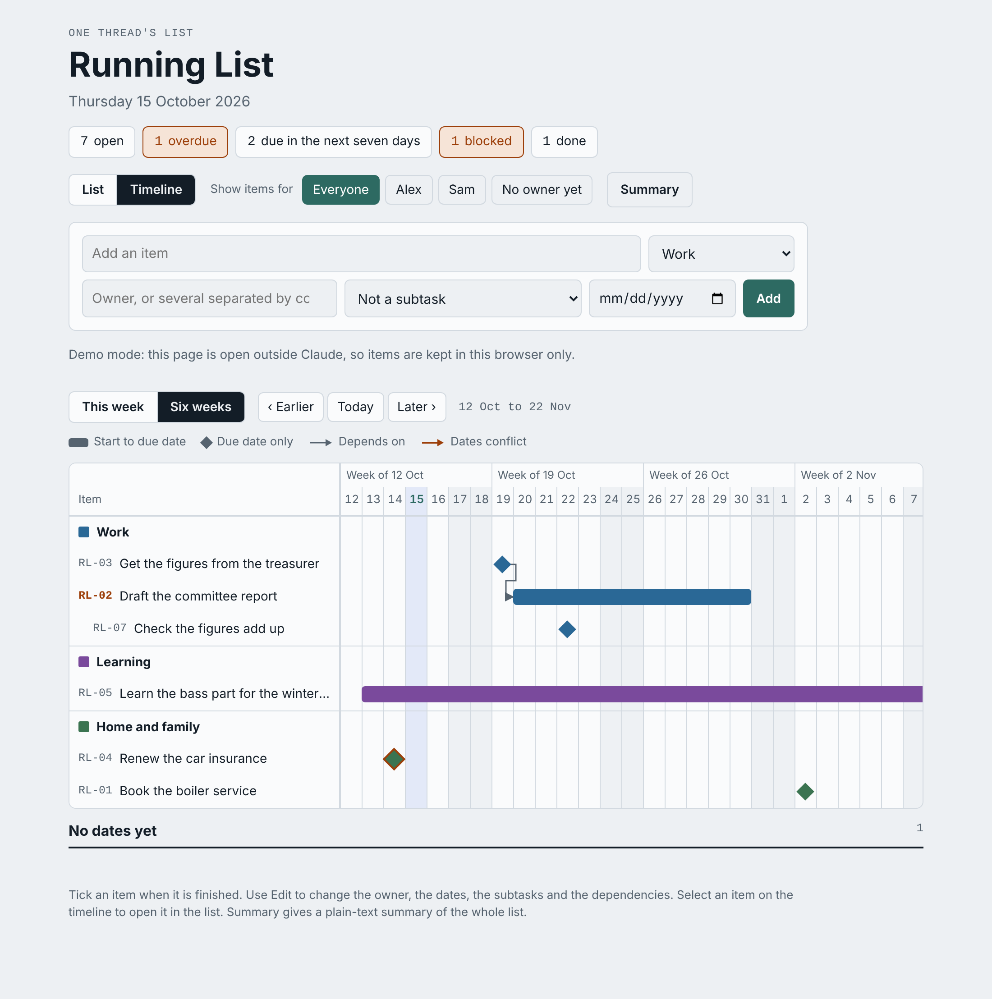

# Chronicle

Thread governance for Claude Projects.

Chronicle is a pattern for running several areas of work and life in one Claude Project without losing or inventing facts. It is a set of rules, document templates, prompts, a task-list page and a hook that makes a chat re-read its documents after compaction. Most of it is Markdown.

I built it in 2026 to run a job search, several ventures, a voluntary role and a personal record side by side in claude.ai. It grew to several threads, each a separate chat with its own folder, list and log, coordinated by one master chat. This repository is the pattern with my content removed.

## The problem it solves

A long-running Claude Project degrades in predictable ways.

- One chat holding everything runs out of context, and the oldest facts go first.
- Two chats give two different answers about the same thing.
- A chat fills a gap with something plausible, and the plausible thing gets copied.
- Instructions written in week one are wrong by week six, and nobody notices.
- A new chat starts cold and has to be told everything again.
- A long chat is compacted into a summary, and the summary drops the handling rules first.

## The pattern in one page

- **Threads.** Each area gets its own chat, with a charter and a folder. Threads do not overlap. Where two touch, each says so in one line and leaves the work to the owner.
- **A constitution.** The project instructions hold the thread table, standing orders about how you want to be treated, and handling rules for private matters. They stay short and stable.
- **A reading order.** Every chat in a thread reads the same documents in the same order before it says anything.
- **A log that wins.** Each thread keeps a dated, append-only log in your words. The log outranks older documents, and you outrank the folder.
- **Record extracts.** When a thread starts, a sourced digest records what the project already knows, with a first section listing where older documents are wrong.
- **Canonical documents.** A record of facts with consistency rules, a list of people with handling notes, and one house style. One master chat keeps them and folds the logs into them.
- **Running lists.** Each thread has a task-list page with its own database. You tick on the page. Chats read and write the same items, pinning each write to the version they last read. Items copy from each thread's list to a master list, and only in that direction.
- **Etiquette.** Never invent: ask. Numbered questions in one batch. Ask before adding to a list. Do not nag. Mark sensitive lines PRIVATE. Correct mistakes and record them, without apology.
- **Handovers.** A thread that retires or moves to a new chat writes an operating guide for its successor.
- **Recovery after compaction.** When a long chat is compacted into a summary, the thread re-reads its context, the house style and its log before it replies. A rule in the project instructions does this on any surface. A Claude Code hook in [hooks/](hooks/) does it automatically.

The reasons for each rule are in [docs/principles.md](docs/principles.md). The architecture and a diagram are in [docs/how-it-works.md](docs/how-it-works.md). A small fictional example is in [examples/worked-example.md](examples/worked-example.md).

## What is in the repository

```
README.md                     this file
LICENSE                       MIT
.claude-plugin/               the plugin manifest, the marketplace file and the icon
docs/
  principles.md               every rule, with the reason for it
  how-it-works.md             the parts, a diagram, costs and lessons
  images/                     screenshots of the running list
skills/chronicle/
  SKILL.md                    the skill: which procedure to follow when
  templates/
    project-instructions.md   the constitution
    thread-context.md         a thread's charter and working notes
    thread-log.md             the dated, append-only log
    record-extract.md         the sourced digest a thread starts from
    operating-guide.md        the handover manual
    house-style.md            a starting house style for prose
    canon-record.md           the record of facts, with consistency rules
    canon-people.md           the people, with handling notes
  prompts/
    start.md                  the starter prompt (below)
    open-thread.md            the first message in each thread
    new-thread.md             adding a thread later
    master-merge.md           folding the logs into the canon
    handover.md               retiring or moving a thread
    daily-summary.md          an optional morning summary
  running-list/
    index.html                the task-list page
    README.md                 configuring, publishing, the data schema
    seed-example.json         eight example items
examples/
  worked-example.md           a fictional project, three weeks in
hooks/
  README.md                   re-reading the documents after compaction
  post-compact.sh             a Claude Code hook that fires only after compaction
  post-compact-brief.md       the brief the hook prints
```

## Installing it

**As a plugin.** Chronicle is packaged as a Claude plugin named `chronicle-threads`. Once its listing in Anthropic's directory is live, add it from the directory on claude.ai. In Claude Code you can install it from this repository now:

```
claude plugin marketplace add WolffSimon/Chronicle
claude plugin install chronicle-threads@wolffsimon-chronicle
```

The plugin carries one skill, `chronicle`, which holds the templates, the prompts and the list page, and tells Claude which procedure fits the moment. You can also work from the files directly, as below.

## Getting started

You need a Claude Project. The running lists need a Claude surface that can publish artifacts with a database. Everything else works with project files alone.

1. Create a new Project.
2. Add the files in `skills/chronicle/templates/` and `skills/chronicle/running-list/index.html` to the Project's files, unless you installed the plugin. Some surfaces drop the folder names on upload. Claude matches the files by name, so that does not matter.
3. Open a new chat in the Project and paste the starter prompt below.
4. Answer Claude's questions. It drafts your project instructions, sets up `master/` and a folder per thread, publishes a list per thread if it can, and gives you an opening message for each thread.
5. Paste the final project instructions into the Project's instructions.
6. Open one chat per thread and paste its opening message.

### The starter prompt

```text
I want to run this Project with the Chronicle pattern for thread governance.
The templates are in this Project's files (templates/) and the list page is
running-list/index.html. Work through the steps below with me, one at a time.
Wait for my answers before moving on.

1. Interview me. Ask your questions numbered, in one batch, each answerable in
   a word or a line:
   - which areas of my work and life should have their own thread (three to
     seven), and for each, its charter in one or two sentences and what it
     must never touch;
   - my standing orders: how I want to be spoken to and what you must never do;
   - subjects that are private or closed, and people who must never be named;
   - whether I already have a house style for prose you draft for me.

2. Draft the project instructions from templates/project-instructions.md.
   Keep them under 1,500 words. Put nothing in them that changes from week to
   week. Show me the draft and wait for my changes. I will paste the final
   version into the Project's instructions myself.

3. Set up master/: House_Style.md (from templates/house-style.md, with my
   rules if I gave any), Record.md and People.md (from the canon templates,
   empty except for what I have told you), and Master_Log.md (from
   templates/thread-log.md).

4. For each thread, create a folder holding Thread_Context.md, Thread_Log.md
   (one entry recording its creation) and Record_Extract_[today].md, from the
   templates. Fill them only with what I have told you. Mark anything you
   could not fill as a question for me in section 11 of the context.

5. If you can publish artifacts with a database, publish one running list per
   thread from running-list/index.html. Before each publish, set CONFIG at the
   top of the script: the title, a two-letter prefix and the thread's
   workstreams. Declare the capabilities db and user (with the profile scope).
   Publish one more copy as the master list, with one workstream per thread.
   Give me each link. Record each thread's link in its context, section 6,
   and the master list's link in master/Master_Log.md. If you cannot publish,
   say so and skip this step.

6. Write the opening message I will paste into each thread's first chat.

Rules while you do this. Never invent a fact about me: ask. Write in plain
sentences, one idea each. If you can write to this Project's files, write
them there. If you cannot, give me each file to download and add, and tell me
the path it belongs at.
```

The other prompts are in [skills/chronicle/prompts/](skills/chronicle/prompts/). The two you will use most are the opening line for a thread and the master merge.

## The running list



The list view at phone width is in [docs/images/screenshot.png](docs/images/screenshot.png).

The list page is one HTML file with no build step. It groups items by workstream, folds subtasks under their parents, draws dated items on a timeline with dependency arrows, and writes a plain-text summary for email. In Claude it uses the artifact database, so the page and every chat see the same items. Opened anywhere else it runs in demo mode and keeps items in the browser.

Configuration, publishing and the data schema are in [skills/chronicle/running-list/README.md](skills/chronicle/running-list/README.md).

## Recovery after compaction

When a long chat fills its context, Claude compacts it: the earlier conversation becomes a summary. Summaries are lossy, and the rules about private subjects and unnamed people are usually the first casualties. A compacted chat then answers with confidence from a partial memory.

The pattern makes a thread re-read its documents after compaction, and only then.

- **On any Claude surface.** The project instructions survive compaction, and a compacted chat can see that it begins from a summary. The template's rules include this line, which every thread obeys:

  ```text
  - If your conversation begins with a summary of an earlier conversation, it
    has been compacted. Before your next reply, re-read your thread's context,
    the house style and your log, in that order.
  ```

- **In Claude Code, automatically.** Claude Code fires a `SessionStart` hook with the source `compact` straight after compaction. [hooks/post-compact.sh](hooks/post-compact.sh) prints a short brief into the context at that moment and stays silent at startup, resume and clear. The brief carries the reading order and the handling rules that must never lapse. Setup and a test are in [hooks/README.md](hooks/README.md).

## Adapting it

- **Start with fewer threads.** Two or three, plus the master, is enough to feel the benefit. Add a thread when an area keeps getting lost.
- **Write your standing orders as you go.** The best ones come from correcting a chat. Bank each correction in the log, then move the lasting ones into the constitution.
- **Grow the house style the same way.** The template is a starting point. Add a rule each time you fix the same habit twice.
- **Keep private facts in the logs, marked.** The pattern records them so no chat has to rediscover them, and keeps them out of summaries and documents.

## Limits

- It costs reading time at the start of every chat. That is the price of not inventing.
- The master merge is manual by design, because it needs your answers.
- On some Claude surfaces chats cannot write project files. The prompts handle that case, and the manual route is slower.
- The pattern keeps chats consistent with the record. Keeping the record true is your job.

## What it runs and what it sends

Chronicle is Markdown, one HTML page and one optional shell script. The skill tells Claude to interview you, write documents into your Project, and publish the list page as an artifact. The list page stores its items in that artifact's database on claude.ai, and it loads its typefaces from Google Fonts in the viewer's browser. The compaction hook in `hooks/` is not switched on by the plugin; you install it yourself if you want it, and it prints a file you name. Nothing in Chronicle reads your credentials or tokens, and nothing else leaves your machine.

## Licence

MIT. See [LICENSE](LICENSE).
