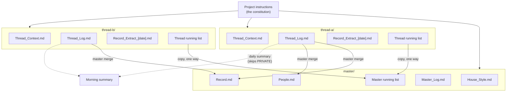

# How it works

## The parts

- **The project instructions** are the constitution. Every chat reads them. They hold the thread table, the standing orders and the handling rules.
- **`master/`** holds the canonical documents and the master list. One chat, the master, keeps them.
- **Each thread's folder** holds its context (the charter and working notes), its log (dated, append-only), and a record extract (what the project already knew when the thread began).
- **Each thread's running list** is an artifact page with its own small database. The person ticks items on the page. Chats read and write the same items through Claude's artifact database tool.
- **The master merge** folds the logs into the canonical documents, on a rhythm the person chooses.
- **The daily summary** is an optional scheduled task that reads the logs and lists each morning.

## A day in the life of a thread

1. The person opens a chat in the thread and pastes the short opening line.
2. The chat reads the context, the house style, the log, the extract and the list, in that order.
3. The person works: "done X", "add Y", a document to draft, a question to answer.
4. Each new fact goes into the log the same day, dated, in the person's words.
5. Ticks go onto the list, pinned to the version the chat last read.
6. When the chat's context fills, the thread hands over: the old chat writes an operating guide or a final log entry, and a new chat starts from the reading order.

## Where it lives

The pattern needs a place for shared documents and, for the lists, artifact pages with a database. It was built in claude.ai Projects, where project files are shared across every chat in the project and published artifacts can declare a `db` capability.

Chats in some Claude surfaces can write project files directly. In others they cannot, and the person adds the files the chat produces. The prompts in `prompts/` handle both cases.

## Costs

- **Reading time.** Every chat spends its first minutes reading. That is the price of not inventing.
- **The merge is manual.** It needs the person's answers, by design.
- **Discipline.** The pattern works because chats follow the reading order and the logging rule. When a chat skips them, the person has to say so.

## Lessons from running it

- **Keep the constitution short.** A version that carried live status went stale in six weeks and every chat spent time reconciling it.
- **Upload the canonical documents.** If the instructions tell every thread to read a document that lives outside the project, no thread can obey.
- **Keep one copy of the house style.** Five copies taken on five days had already started to drift.
- **Back up anything kept outside the project.** Working files in a chat's sandbox can disappear when the session ends.
